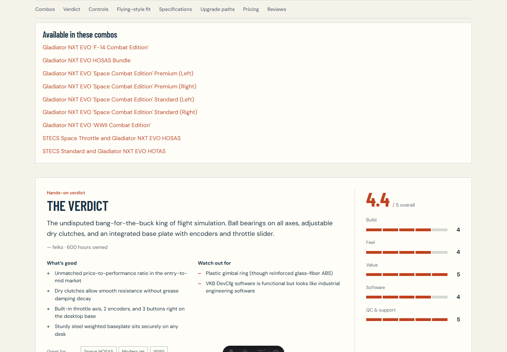
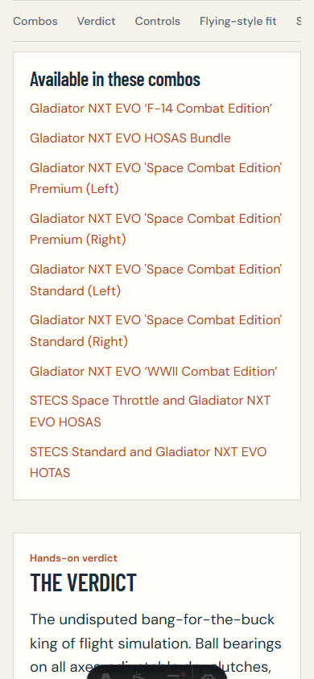

# Issue #15 verification

2026-10-25, local development server from `issue-15-combo-parts`.

- `pnpm check`: passed, zero errors/warnings; five existing Zod deprecation hints.
- `pnpm test`: 18 files, 133 tests passed. Initial cold run timed out in two existing content-loading tests; subsequent full runs passed without changing their timeout configuration.
- `pnpm build`: passed, including Pagefind (288 pages). Existing large-chunk warning remains.
- `git diff --check`: passed.

Browser behavior verified in Brave at desktop (measured 1152 CSS pixels) and 390 CSS pixels:

- Searching Gladiator NXT EVO Base returns no result by default, one with Show individual parts enabled; URL gains `showIndividualParts=1`.
- X52 Throttle is discoverable with the toggle and hidden without it.
- Reload/shared URL restores both individual-parts and discontinued checkboxes. Turning off individual parts preserves `showDiscontinued=1`; Reset all removes both and preserves `#hardware`.
- Mobile filter disclosure opens; zero-result state and reset work.
- Gladiator family card remains collapsed with edition and handedness choices; selecting Standard changes the displayed product. UK/EU switching updates regional results.
- Base detail lists nine containing combos; following Premium Right reaches its combo page and the existing included-component link returns to the base.
- No horizontal document overflow on catalog or base detail at 390px.
- Existing visibility, family, successor and wizard regressions pass in the full test suite. New tests cover strict/soft hiding, independent discontinued opt-in, projection, combo availability, and continued wizard eligibility of soft-flagged base/grip pairs.

T3 preview snapshots timed out twice, so interactive verification used the browser extension. After final combo-section styling, the extension also stopped responding. Final visual verification used the installed Chrome through Playwright's screenshot CLI at 1440×1000 and 390×844; both images were inspected. No production/deployed checks were performed.

