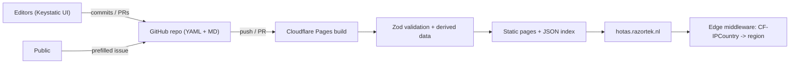
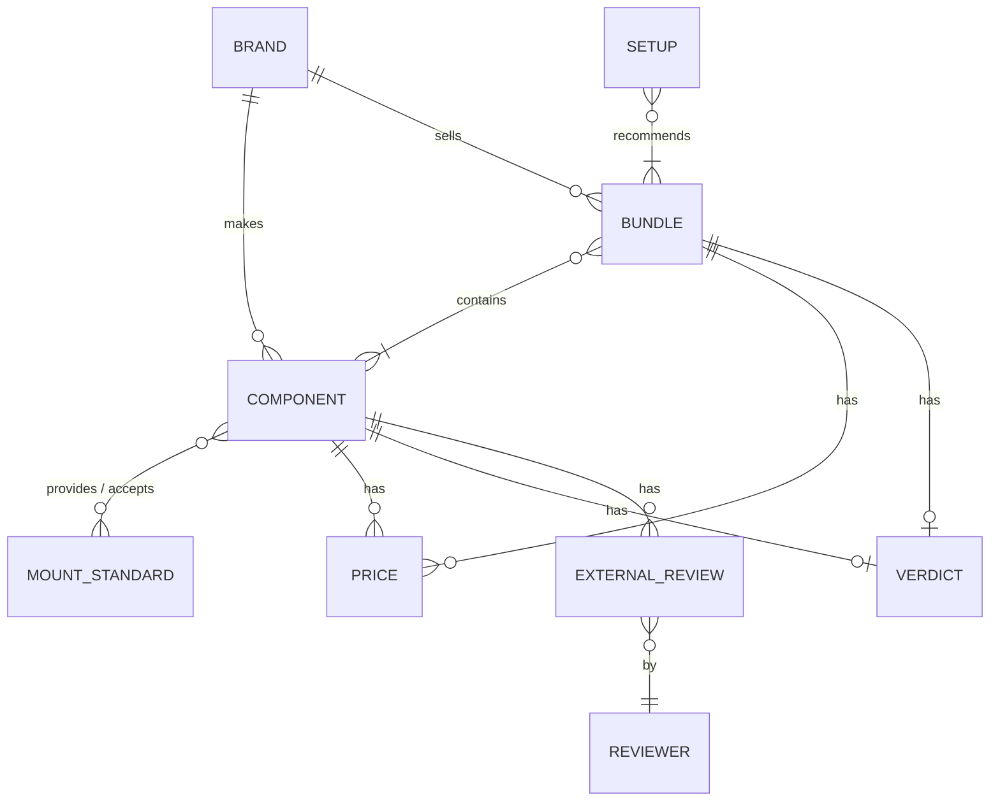

# hotas-compare — Implementation Plan

Working title **hotas-compare**, test deployment at `hotas.razortek.nl`.
An opinionated, community-oriented compare site + buyer's guide for sticks, throttles, yokes, quadrants and rudder pedals.

## 1. Decisions (from grill-me)

| # | Topic | Decision |
|---|---|---|
| 1 | Goal | Opinionated community resource first; affiliate-ready later |
| 2 | Editors | You + 1–3 trusted editors; public sends corrections via prefilled GitHub issues |
| 3 | Data storage | Git-based: one YAML file per entity, strict schema, static build |
| 4 | Modularity | Component model (base, grip, throttle, pedals, yoke, quadrant, module) + **Bundles** (real SKUs) + mount-standard compatibility |
| 5 | Spec depth | Typed **controls list** per component; totals are computed. Plus core hardware fields |
| 6 | Prices | Manual per (item, region, store) for EU/UK/US with `verified` date + staleness flag; per-brand landed-cost notes; schema ready for feeds |
| 7 | Opinions | Your verdict (take, pros/cons, best-for/skip-if, 1–5 scores, hands-on flag) + curated external reviews (link, timestamp, own-words summary, verdict tag) |
| 8 | Wizard | Hybrid: curated reference setups per use case × budget tier + transparent rule-based scorer |
| 9 | Stack | Astro + TypeScript, content collections + Zod, Svelte 5 islands, Tailwind, Pagefind |
| 10 | Repo/CI | GitHub, native integration |
| 11 | CMS | Keystatic (GitHub mode in prod, local in dev); Zod as final build gate |
| 12 | Launch data | ~80–120 components, ~11 brands (WinCtrl = formerly WinWing), AI-drafted from manufacturer pages, `verification: draft` until signed off; discontinued-but-popular items included |
| 13 | v1 scope | Catalog + filters, product pages, compare (≤4), region switcher, wizard, shareable URLs, "suggest correction" |
| 14 | Images | Manufacturer images, with `source` recorded per image |
| 15 | Style | Dark cockpit/MFD theme, one accent (amber), monospace numbers, light-mode toggle |
| 17 | Islands | Svelte 5 |
| 18 | Hosting | Cloudflare Pages, `hotas.razortek.nl`, `CF-IPCountry` middleware for region, browser-locale fallback |

## 2. Architecture



- **Static first**: every component, bundle, brand, compare preset and guide is pre-rendered.
- **One small server part**: Astro Cloudflare adapter for Keystatic's GitHub OAuth routes + region middleware.
- **Client-side data**: the build outputs a compact `catalog.json` (derived totals, prices per region, tags, scores) used by the filter, compare and wizard islands.

## 3. Repo layout (proposed)

```
src/
  content/
    brands/            virpil.yaml, vkb.yaml, ...
    mount-standards/   virpil-grip.yaml, vkb-grip.yaml, tm-din5.yaml, ...
    components/        virpil/constellation-alpha-prime-r.yaml, ...
    bundles/           vkb/gladiator-nxt-evo-sce-r.yaml, ...
    setups/            space-600-eur.yaml (curated reference setups)
    reviewers/         mysh.yaml, ...
    guides/            *.mdx (v1.1)
  content.config.ts    Zod schemas (source of truth for validation)
  lib/derive.ts        totals, compatibility, price resolution, scoring
  components/          Astro + Svelte islands (Filters, Compare, Wizard, RegionSwitcher)
  pages/
keystatic.config.ts    Editing schema (mirrors Zod)
public/images/...
```

## 4. Data model (draft)



### Component (example)

```yaml
id: virpil-constellation-alpha-prime-r
brand: virpil
name: Constellation Alpha Prime (Right)
category: grip            # base | grip | stick_fixed | throttle | quadrant | yoke | pedals | module
status: current           # current | discontinued | announced
release_year: 2021
handedness: right         # left | right | ambi | n/a
mount:
  provides: virpil-grip   # for grips
  # accepts: [virpil-grip] for bases
controls:
  - { type: trigger, stages: 2 }
  - { type: hat, ways: 8, push: true, count: 2 }
  - { type: hat, ways: 4, push: true }
  - { type: analog_ministick, push: true }
  - { type: button, count: 4 }
  - { type: lever, kind: brake, analog: true }
  - { type: encoder, count: 0 }
hardware:                 # mostly base / pedals / throttle fields; optional per category
  gimbal: null            # dual_spring | cam | gimbal_ring | ball_joint | ...
  sensor: null            # hall | tmr | contactless_magnetic | potentiometer | optical
  axes: []                # [{ name: x, resolution_bits: 16, sensor: hall }]
  force_adjustable: null
  cams_swappable: null
  damping: null
  extension_support: null
  throw_deg: null
connectivity: { usb: c, standalone_usb: false }
software: virpil-vpc-configurator
physical: { weight_g: 520, materials: [aluminium, abs] }
use_case_fit: { modern_jet: 5, heli: 4, ww2: 4, ga: 2, airliner: 1, space_hotas: 4, space_hosas: 5 }
verification: draft       # draft | verified
sources:
  - https://virpil-controls.eu/...
images:
  - { file: alpha-prime-r.webp, source: https://virpil-controls.eu/... }
```

**Derived at build time:** logical button count, physical hat count by type, analog axes, has ministick, has brake axis, etc. For bundles: combined totals across components.

### Price

```yaml
# inline per component/bundle
prices:
  - { region: EU, currency: EUR, amount: 289, incl_vat: true,  store: virpil-controls.eu, verified: 2026-10-01 }
  - { region: UK, currency: GBP, amount: 255, incl_vat: true,  store: virpil-controls.eu, verified: 2026-10-01 }
  - { region: US, currency: USD, amount: 299, incl_vat: false, store: virpil-controls.us, verified: 2026-10-01 }
```
- Stale if `verified` is older than 90 days → badge + CI warning report.
- Brand-level `landed_cost_notes[region]` (shipping origin, duties, handling).
- `source: manual | feed` field reserved for future scraper/affiliate feeds.

### Verdict + external reviews

```yaml
verdict:
  author: feiko
  hands_on: true
  owned_hours: 400
  take: "The best 'one grip does everything' ..."
  pros: [...]
  cons: [...]
  great_for: [space, modern_jet]
  skip_if: ["You want a cheap entry point"]
  scores: { build: 5, feel: 5, value: 3, software: 4, qc_support: 4 }
external_reviews:
  - { reviewer: mysh, url: "https://youtu.be/...?t=312", summary: "...in your own words...", tag: recommended, date: 2025-03-01 }
```

## 5. Wizard

1. **Use case**: modern jet / helicopter / WWII / GA / airliner / space HOTAS / **space HOSAS** (own path: dual sticks, left+right variant pairing, mixed-brand pairs, twist/ministick/strafe-axis emphasis, desk-edge or chair mounts) (+ optional sims: DCS, MSFS, X-Plane, IL-2, Star Citizen, Elite).
2. **Pieces needed**: stick, throttle, pedals, yoke, quadrant; existing gear to keep. (HOSAS path: second stick replaces throttle.)
3. **Budget** in region currency (total).
4. **Constraints**: desk vs chair/floor mount, handedness, small desk.
5. **Output**:
   - Matching **curated reference setups** first (with your reasoning).
   - **Scored alternatives**: `fit(use case) × your scores × price-in-region × constraint rules`. Each result says *why* (e.g. "+ twist axis because no pedals selected").
   - Shareable URL encoding all answers.

## 6. Roadmap

| Phase | Content |
|---|---|
| **0. Scaffold** | Astro + Svelte 5 + Tailwind + Keystatic + Cloudflare adapter; GitHub repo; CF Pages + `hotas.razortek.nl`; theme tokens |
| **1. Data model** | Zod schemas + Keystatic config + `derive.ts` + unit tests; 5–10 hand-checked reference items |
| **2. Seeding** | AI-drafted YAML for ~80–120 components across brands (`draft`), mount standards, bundles |
| **3. Pages** | Catalog + faceted filters, component/bundle pages, brand pages, compare (≤4, diff highlighting), region switcher, shareable URLs, correction links |
| **4. Wizard** | Curated setups + scorer + explanations |
| **5. Launch prep** | Your verdicts on top items, verify specs, SEO (OG images, sitemap, structured data), Pagefind, final name/domain |
| **v1.1** | Setup builder with compatibility warnings, guides (MDX), price history |
| **Later** | Affiliate links, more regions (CA/AU), photo hotspots, community ratings |

## 7. Open questions

- **Brand renames**: brands get a `former_names` field (e.g. WinCtrl → `[WinWing]`) so search, filters and SEO still match the old name, and older products (e.g. Orion 2, Ursa Minor) keep the brand page together under WinCtrl with a "formerly WinWing" note.
- **Brand list (decided)**: Virpil, VKB, WinCtrl (ex-WinWing), Moza, MFG, Thrustmaster (incl. T.Flight line), Logitech/Saitek, Honeycomb, Turtle Beach, Slaw. Hori excluded for now. Candidates for later: CH (legacy), Simgears, Ruddy.
- **Use-case taxonomy (decided)**: modern jet, helicopter, WWII, GA, airliner, space HOTAS, space HOSAS.
- **GitHub owner (decided)**: personal GitHub account.
- **Score dimensions (open, default)**: build / feel / value / software / QC-support. Can be extended later without breaking data.

## 8. Verification

- `astro check` + Zod validation fail the build on bad data.
- Vitest unit tests for `derive.ts` (totals, compatibility, price resolution, scoring).
- CI report for stale prices and `draft` items.
- Manual browser check of catalog, compare, wizard and region switching on CF preview URLs.
